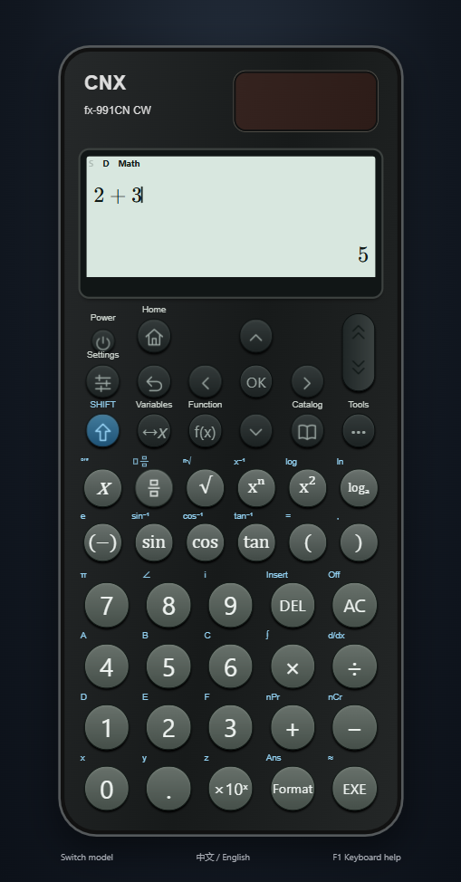
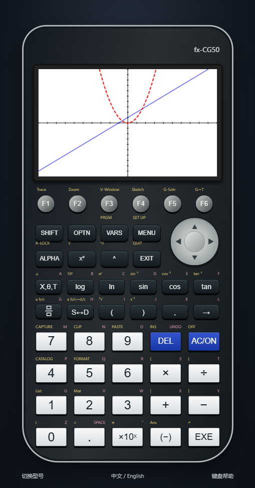

# scientific calculator simulator

**Offline, multi-model scientific calculator for Windows**

**English** | [简体中文](README.zh-CN.md)

scientific calculator simulator is an independent JavaScript/Electron application. Model-specific keyboards, menus and limits share one mathematical engine. It supports English and Simplified Chinese, mouse and keyboard input, and runs without accounts, API keys or an internet connection.

No calculator firmware, manufacturer logos or proprietary artwork are included. This project is not affiliated with or certified by Casio or Texas Instruments.

## Models and status

| Model | Status | Implemented scope |
| --- | --- | --- |
| fx-991CN X | Available | Ten modes, SHIFT/ALPHA, CALC/SOLVE, memory M and CODATA 2010 constants |
| fx-991CN CW | Experimental | 48-key layout, paged HOME, Catalog/Tools/Format, f/g registration, 45/30-row tables and 47 CODATA 2018 constants |
| fx-999CN CW | Experimental | First-generation white CW layout, twelve HOME apps, seven distributions, 45-entry discrete lists and an A1:E45 spreadsheet |
| TI-36X Pro | Experimental | Multi-tap keys, eight variables, six-row MODE, 20 constants, seven distributions, Auto/Ask-x tables, 40 conversion directions, op/setop, mixed-number entry and software contrast |
| fx-CG50 | Experimental | Nineteen application workflows; twenty graph slots with multiple relation types, analysis/sketch/modify and graph memories; six statistical List Files, spreadsheets, recursion, programs, finance, geometry and 3D |
| fx-991EX | Experimental | Independent English keyboard, twelve apps with 1–9/A/B/C menu, nine variables, Calculate SOLVE, 45/30-row tables, distributions, a volatile A1:E45 spreadsheet and simulator-text QR export |

**No model has complete hardware parity.** Available describes the existing usable implementation, not certification. Experimental models provide documented working subsets, with unfinished native menus, visual details and numerical domains. Unsupported actions report their status.

See the [compatibility matrix](docs/COMPATIBILITY.md), [current usability scope](docs/USABILITY.md), [999 scope](docs/999CW.md), [TI scope](docs/TI36XPRO.md), [CG50 graph scope](docs/CG50.md) and [CG50 applications](docs/CG50_APPLICATIONS.md). These documents are English, Chinese or bilingual.

## Getting started

Build this checkout using the commands below. **The next GitHub release, v0.4.0, is being prepared from local development through 0.13.0.** Current local validation and installation evidence is recorded in [VERIFICATION.md](docs/VERIFICATION.md).

- Run the Windows x64 portable EXE directly. For an unpacked build, keep the entire directory together and run `scientific calculator simulator.exe`.
- On first launch, select a model. Use **Switch model** to return to the selector.
- The same package detects the preferred OS interface language: Chinese locales use Simplified Chinese; other locales use English. A saved manual choice takes precedence.
- Language is an application preference. Calculator chassis headers contain no language-edition badge.
- Each model keeps its own history, real variables, settings and supported data. Interface language is shared. Switching clears unsubmitted input.
- Legacy `cnx-v1` data migrates to the X profile; the old storage key remains available for rollback.

Calculator data is stored in the local Electron user-data directory. Clearing that directory can remove saved work. Complex Ans and matrix/vector answer registers are session values. The 999 spreadsheet is volatile: switching models, power operations or restarting clears it. EX also clears its spreadsheet and statistics when leaving their applications. See the model documentation before relying on device-specific retention.

## Features

- Arithmetic, fractions, powers/roots, logarithms, trigonometry and angle units.
- Complex numbers, matrices, vectors, polynomial equations, linear systems, inequalities and ratios, subject to each model's limits.
- Frequency statistics, regression, function tables, numerical integration/differentiation and bounded sums/products.
- Model-specific probability distributions and spreadsheets; CG50 adds six List Files, three statistical graph configurations, hypothesis tests and confidence intervals.
- CG50 programs, finance, three-sequence recursion, eActivity, geometry, Picture Plot and sampled 3D graphs, with model-workspace JSON backup/restore.
- Scanner-readable EX calculation-text QR export, software idle power-off, TI contrast and CG50 brightness settings.
- Natural formula entry, editable data cells, calculation history and offline function suggestions with Tab completion.
- Per-model settings and histories; English/Chinese switching without separate downloads.
- A responsive model library with configuration-based calculator previews, clear model names/status and keyboard access. X/EX use revised silver-edged shells, round controls and four-column icon menus; the scrolling menu retains the previous row.

On X, enter an equation in **Calculate**, use **ALPHA CALC** for `=`, then **SHIFT CALC** for SOLVE. Edit variable values and select the unknown without leaving Calculate. CW/999 keep Solver in **Equation**. Fraction keys use stacked numerator/bar/denominator symbols, capture a preceding numerator, and distinguish SHIFT mixed-number input from the division operator. See [native input and layout fixes](docs/NATIVE_INPUT.md) for verified sequences and remaining differences.

Numerical algorithms use IEEE 754 doubles. SOLVE, polynomial roots, calculus and regression outputs retain approximate-result semantics. Other fraction/radical recognition is bounded numeric recognition, not a general computer algebra system. SOLVE finds one local real root and does not guarantee all roots. Ill-conditioned inputs and unresolved features may be rejected or missed.

CG50 Link can inspect/preserve G3M archive records and decode/encode the footer-free CP0001 RGB565 G3P picture variant. Native G3M program tokens, G3E eActivity strips, CASIO's proprietary WES QR payload/service and the EA200 native protocol are not implemented. No physical calculator or original vendor files were available for comparison; project tests and working menus do not establish complete manual or hardware parity.

## Screenshots

Actual local Electron windows; both interface languages are supported.


[Interface scope](docs/INTERFACE.md) · [X chassis](docs/classwiz-x.png) · [EX scope](docs/FX991EX.md) · [EX menu](docs/ex-menu.png) · [EX spreadsheet](docs/ex-spreadsheet.png)



[Model selector](docs/model-picker-en.png) · [Chinese CW](docs/cw-calculator.png) · [Tab completion](docs/completion-en.png) · [999 HOME](docs/999-home.png) · [999 distributions](docs/999-distribution.png) · [999 spreadsheet](docs/999-spreadsheet.png)



[TI MODE](docs/ti-mode.png) · [X calculator](docs/calculator.png) · [Matrix input](docs/matrix.png)

## Development and testing

Use **Node.js 24 LTS** and npm. Windows 10/11 x64 is the current desktop packaging target. The initial dependency installation requires downloads; the packaged application runs offline.

```sh
npm ci
npm test
npm run build
npm start
```

```sh
npm run dev          # Local Vite preview
npm run test:ui      # Build first; launches actual Electron windows
npm run release:win  # Windows x64 portable EXE; never publishes
npm run pack         # Windows unpacked directory
npm run licenses    # Collect dependency notices
```

Outputs are in `release/`; local test evidence is in `.verification/`. Set `CNX_ELECTRON_PATH` to run UI checks against a packaged executable.

CI is configured for core tests/builds on Linux and core tests, actual Electron UI, packaging and packaged UI on Windows. Failed Windows steps retain logs/screenshots and report failure explicitly. CI configuration is not evidence of a successful hosted run; consult the [verification record](docs/VERIFICATION.md) for actual pass/fail/not-run counts.

## Keyboard

| Keys | Action |
| --- | --- |
| F12 | Switch interface language |
| F4 / Home | Model menu, except CG50 F4 is its native soft key |
| Enter | Calculate, confirm or advance a field |
| Escape | Return or clear the current input |
| Tab / Shift+Tab | Complete suggestions or navigate formula placeholders |
| Ctrl+Space | Request function suggestions |
| Ctrl+Enter | Submit a parameter form |
| Ctrl+Z / C / V | Undo / copy / paste |
| F1 | Help on scientific profiles; CG50 uses F7 |

Physical keys and desktop shortcuts differ by model. Open **Keyboard help** in the application for the active mapping. CW has no physical ALPHA, independent M, CALC or S⇔D key.

## Contributing and documentation

- [Contributing](CONTRIBUTING.md), [Code of conduct](CODE_OF_CONDUCT.md), [Security policy](SECURITY.md)
- [Architecture](docs/ARCHITECTURE.md), [Compatibility](docs/COMPATIBILITY.md), [Roadmap](docs/ROADMAP.md), [Changelog](CHANGELOG.md)
- [Verification](docs/VERIFICATION.md), [Third-party notices](docs/THIRD_PARTY_NOTICES.md)

Please keep the English and [Simplified Chinese](README.zh-CN.md) READMEs consistent. Technical documentation may be Chinese/bilingual; its language is stated rather than implying every document has an English translation.

## License and trademarks

Original source is licensed under the [MIT License](LICENSE). Third-party components retain their own licenses and notices.

CASIO, ClassWiz, Texas Instruments and referenced calculator model names are trademarks of their respective owners. Names identify reference products only; no manufacturer endorsement, firmware emulation or complete device compatibility is claimed.
