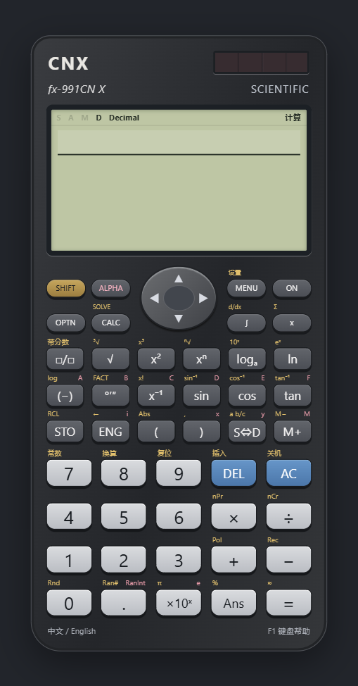

# CNX Calculator

面向 Windows 的离线科学计算器，参照 **Casio fx-991CN X** 的十种模式、中英文菜单与实体按键布局设计。打开即用，支持键盘与鼠标，运行时无需联网、账号或 API Key。源码采用 MIT 许可证。



## 下载与启动

从 [Releases](https://github.com/plateboheng-cell/fx-991cnx/releases) 下载 `CNX-Calculator-0.2.0-Windows-x64.exe`，双击启动。首次解包需要几秒。也可下载 ZIP，解压整个目录后运行 `CNX Calculator.exe`，请保留同目录的其他文件。

平台：Windows 10/11 x64。分数、根式与公式字体随包提供；完全离线。应用数据存放在用户目录的 Electron 应用数据中，保存角度设置、历史、实数变量、矩阵、向量和统计数据。

界面语言可在 **F11 → 语言 / Language** 或底部 **中文 / English** 按钮中选择；**F12** 快速切换，关闭后保留选择。功能参数首次打开均为空白，返回结果编辑时保留用户填写的数据；退出功能后，菜单仍选中刚才使用的项目。

## 十种模式

按 **F4** 或 **Home** 打开主菜单，使用数字键或方向键选择，Enter 确认。

| 按键 | 模式 | 已实现 |
| --- | --- | --- |
| 1 | 计算 | 四则、分数、幂根式、对数、三角与反三角、双曲与反双曲、阶乘、排列组合、随机数、GCD/LCM、取整、坐标转换、度分秒、Σ/Π、数值积分/微分、CALC、SOLVE |
| 2 | 复数 | 四则、幂、共轭、模、辐角、实虚部、极坐标输入/输出 |
| 3 | 基数 | 二/八/十/十六进制，32 位有符号整数、AND/OR/XOR/XNOR/NOT/NEG |
| 4 | 矩阵 | MatA–MatD，最大 4×4，加减乘、逆矩阵、行列式、转置、单位矩阵、RREF、MatAns |
| 5 | 向量 | VctA–VctD，2/3 维，加减、数乘、点积、叉积、模、夹角、单位向量、VctAns |
| 6 | 统计 | 频数、均值、总体/样本标准差、平方和、极值、中位数、四分位数；线性/二次/对数/两种指数/幂/反比例回归与预测 |
| 7 | 表格 | f(x) 与 g(x)，自定义起点/终点/正负步长，最多 45 行 |
| 8 | 方程/函数 | 2–4 元线性方程组、2–4 次多项式及复根、一般实数方程数值求解 |
| 9 | 不等式 | 2–4 次，> / < / ≥ / ≤，区间、单点、全体实数和空集 |
| 0 | 比例 | A:B=X:D 与 A:B=C:X |

另外提供 47 个 CODATA 2010 科学常数、40 个方向的单位换算、A–F/x/y/z 变量及独立存储器 M、Ans、历史重放、撤销、Fix/Sci/Norm、S⇔D 和工程计数法。

## 完全用键盘操作

| 按键 | 操作 |
| --- | --- |
| F1 | 完整键盘帮助 |
| F2、F3 | SHIFT、ALPHA，随后按对应数字/按键，或 Tab 到目标按键后空格 |
| F4 / Home | 主菜单，1–9 / 0 选择模式 |
| F5 | 当前模式选项 / 函数目录 |
| F6 / Shift+F6 | CALC / SOLVE |
| F7 / F8 | 科学常数 / 单位换算 |
| F9 / Shift+F9 | S⇔D / 带分数 |
| F10 / F11 | 展开屏幕 / 设置 |
| F12 | 切换中文 / 英文 |
| Enter / = | 执行；参数页面 Enter 下一项，最后一项计算 |
| Escape | 返回；计算页面清空算式 |
| Shift+Delete | AC |
| Backspace / Delete / Insert | 删除左边 / 删除右边 / 插入覆盖切换 |
| ↑↓ / ←→ | 菜单导航、历史重放、移动光标；结果页滚动 |
| Tab / Shift+Tab | 访问每个参数和屏幕按键 |
| Ctrl+Z / Ctrl+C / Ctrl+V | 撤销 / 复制选中内容或结果 / 粘贴 |
| Shift+Enter | 多行数据框中换行 |

直接键入算式，例如 `sin(30)`、`log(8,2)`、`nCr(1000,2)`、`sqrt(2)`、`(1+2i)*(3-4i)`。支持小键盘。

积分 `integral("x^2",0,1)`，微分 `diff("sin(x)",30)`，求和 `sum("x",1,100)`，求积 `prod("x",1,5)`。函数中的自变量用小写 x；三角函数与微积分遵从当前 Deg/Rad/Gra 设置。F5 也提供参数页面，无需记住函数语法。

矩阵：每行换行，同一行使用逗号或空格分隔。统计：单变量每行 `x,频数`；双变量每行 `x,y,频数`，频数可省略，默认 1。

## 与真机的兼容范围

**这是独立实现的 v0.2.0，尚不能宣称功能及行为与真机 100% 相同。** 未包含或调用卡西欧固件。十个模式均可操作，但以下差异必须明确：

- 输入使用可编辑的线性算式，并提供自然数学预览及分数/根式结果；尚未实现真机二维模板光标编辑、循环小数输入与所有自然格式输出规则。
- 菜单、数据编辑器及部分按键的参数步骤为桌面适配，并非逐帧复制。机身使用原创 CSS 与 CNX 标识，没有复制官方 Logo、照片或字体。
- 内部使用 IEEE 754 双精度与独立数值算法；显示默认 10 位有效数字。分数/π/简单根式依据数值识别，不是通用符号代数系统。退化/病态方程、高重数或非常接近的根、振荡/奇异积分等边界未获真机一致性认证。SOLVE 只寻找初值附近的一个实根。
- 基数使用统一 32 位二补码；真机各进制的位数限制、溢出及负数输入规则可能不同。当前加乘溢出按 32 位回绕。
- 常数按说明书所述的 CODATA 2010 数据维护，常数项目及单位换算方向对照说明书参考单；末位截断、换算常数的真机内部精度未逐项比对。
- 当前保存实数变量；复数变量和 MatAns/VctAns 在当前会话可用，重启后不保留。暂无真机的自动关机、屏幕对比度、工程前缀输入及完整异常位置定位。
- 测试覆盖代表性功能和错误场景，未完成原机全部标称函数及所有输入域的逐项认证。不能把测试数量解释为真机功能数量。

完整范围及验收记录见 [兼容清单](docs/COMPATIBILITY.md) 和 [验证记录](docs/VERIFICATION.md)。欢迎携带真机按键序列、角度/格式设置、预期结果及实际结果提交 issue。

## 从源码运行

要求 Node.js **24 LTS 或更新版本**，npm，Windows x64（构建 Windows 程序）。

```sh
npm ci
npm test
npm run build
npm start
```

开发预览：`npm run dev`，访问终端给出的本机地址。打包便携 EXE：`npm run release:win`；输出位于 `release/`。仅生成解压目录：`npm run pack`。实际 Electron 窗口自动测试：`npm run test:ui`（先 build）。

如果 Electron 二进制下载失败，使用 GitHub 官方 Electron Release 下载与锁定版本匹配的 `electron-v44.8.0-win32-x64.zip`，核对 `node_modules/electron/checksums.json` 的 SHA-256，解压至 `node_modules/electron/dist/`，在 `node_modules/electron/path.txt` 中写入 `electron.exe`。不要从不明来源替换运行时。

CI 在 Windows 中运行核心测试、打包和实际 Electron 界面测试。首次推送 main 后自动根据 package.json 的版本创建 GitHub Release，并上传 Windows 便携 EXE、ZIP 和 SHA-256 校验文件；发布更新时须先递增 package.json 版本。也支持推送 `v*` tag 触发。

## 资料与许可

- [Casio fx-991CN X 官方产品资料](https://www.casio.com.cn/scientific-calculators/product.FX-991CNX-BK/)；[原版用户说明书镜像](https://manuals.plus/m/9c6b41d1f8e83c52eb602fd18a154beda8144dbb748a12661712ebc2dcaac12c.pdf)。说明书仅作为功能参考，未纳入发行包。
- [NIST CODATA 2010 常数表](https://physics.nist.gov/cuu/Constants/ArchiveASCII/allascii_2010.txt)。
- 第三方组件：mathjs（Apache-2.0）、KaTeX（MIT，字体按组件许可证分发）、Electron（MIT 及 Chromium 第三方声明）；构建工具的依赖许可证见各包及随包声明。

CASIO、ClassWiz、fx-991CN X 为其权利人的商标。本项目为独立开源软件，与卡西欧无隶属、合作或官方认证关系。项目原创源码采用 [MIT License](LICENSE)。
