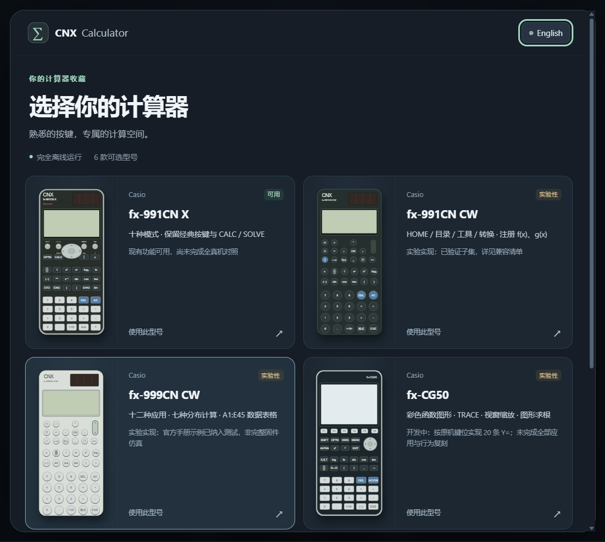
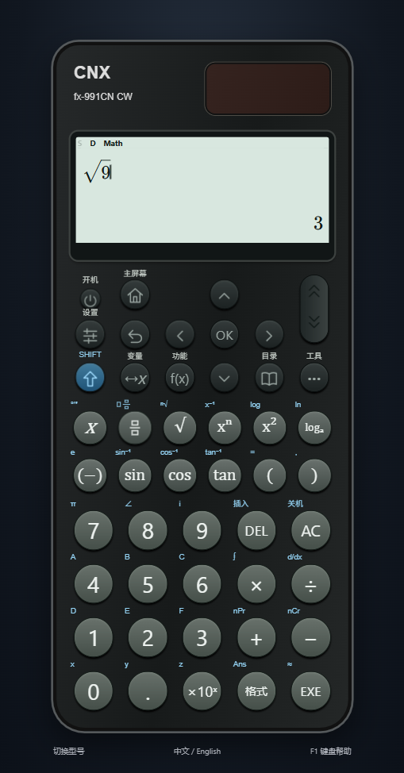

# scientific calculator simulator

**Windows 离线、多型号科学计算器**

[English](README.md) | **简体中文**

scientific calculator simulator 是独立的 JavaScript/Electron 开源实现。不同型号共用数学引擎，各自配置菜单、键盘、变量和功能限制。支持中文、英文、鼠标和键盘，运行时不需要网络、账号或 API Key。

项目不使用计算器固件、厂商 Logo 或未经授权的素材，不代表 Casio 或 Texas Instruments 官方产品或认证。

## 型号与状态

| 型号 | 状态 | 实际实现 |
| --- | --- | --- |
| fx-991CN X | 可用 | 十种模式、SHIFT/ALPHA、CALC/SOLVE、M 和 CODATA 2010 常数 |
| fx-991CN CW | 实验性 | 48 键、HOME 分页、目录/工具/转换、f/g、45/30 行函数表、47 项 CODATA 2018 常数 |
| fx-999CN CW | 实验性 | 第一代白色款、十二应用 HOME、七种分布、45 项离散列表、A1:E45 数据表格 |
| TI-36X Pro | 实验性 | 多击键、八变量、六行 MODE、工程/极坐标/CLASSIC、20 常数、七种分布、Auto/Ask-x 及型号求解/矩阵限制 |
| fx-CG50 | 实验性 | 20 条 Y=、绘图/追踪、五种线型、缩放/视窗、根/极值/交点、坐标计算与积分 |
| fx-991EX | 实验性 | 独立英文键盘、十二应用与 1–9/A/B/C 菜单、九变量、计算模式 SOLVE、45/30 行函数表、分布与退出即清空的数据表格 |

**没有任何型号达到完整真机等价验收。** 可用指已有实现可操作；实验性指有可靠资料依据的可用子集，仍有原生菜单、外观细节和数值域差异。未实现的入口明确说明状态。

详见[兼容矩阵](docs/COMPATIBILITY.md)、[可用性范围](docs/USABILITY.md)、[999](docs/999CW.md)、[TI](docs/TI36XPRO.md)及[CG50](docs/CG50.md)说明。

## 开始使用

可按下方命令构建当前源码。**正在准备 GitHub v0.4.0，包含截至本地 0.13.0 的开发成果。** 本地验证和安装状态见 [VERIFICATION.md](docs/VERIFICATION.md)。

- Windows x64 便携 EXE 可直接运行；解包目录必须完整保留，再打开 `scientific calculator simulator.exe`。
- 首次运行选择型号；底部“切换型号”可随时返回。
- 同一个包自动识别系统首选界面语言：中文地区使用简体中文，其他语言使用英文。保存过的手动选择优先。
- 语言由软件设置控制，计算器机身不显示语言版本标记。
- 每个型号独立保存历史、实数变量、设置和支持的数据；语言共用。切换清除未提交输入。
- 旧 `cnx-v1` 数据仅迁移到 X，并保留旧键作为回退备份。

用户数据保存在本机 Electron 用户目录中，清除目录会导致数据丢失。复数 Ans、矩阵/向量答案寄存器为会话值。999 数据表格不持久化，切换型号、电源操作或重启会清空。EX 的数据表格及统计数据在离开对应应用时也会清空；具体保留规则以型号说明为准。

## 功能与边界

- 四则、分数、幂根式、对数、三角函数与角度单位。
- 复数、矩阵、向量、方程、不等式、比例，遵循各型号限制。
- 频数统计、回归、函数表、数值积分/微分、有限求和/求积。
- 型号特定的概率分布与 999 数据表格。
- 自然公式、数据网格、历史与离线函数提示；Tab 补全。
- 型号独立状态、中英文手动切换，无需分别下载语言包。
- 带机型外观预览与清晰型号/状态的响应式型号库；X/EX 校正银色外沿、圆形控制键、四列图标菜单和保留上一行的滚动方式。

X 的 SOLVE 在第一个“计算”模式中使用：输入方程，**ALPHA CALC** 输入等号，**SHIFT CALC** 打开变量初值并选择未知量求解。CW/999 的求解器保留在“方程”应用。分数键使用上下框和横线图标，可捕获已输入的分子；SHIFT 分数键输入带分数，除号键保留中缀除法。详见[输入与布局修复说明](docs/NATIVE_INPUT.md)。

数值引擎使用 IEEE 754 双精度。SOLVE、多项式根、微积分和回归结果保留近似语义。其他分数/根式识别不是通用符号证明。SOLVE 只求一个局部实根，不保证全根；病态数据或无法解析的特征可能被拒绝或遗漏。

## 实际界面



[外观范围](docs/INTERFACE.md) · [新版 X](docs/classwiz-x.png) · [EX 实现与限制](docs/FX991EX.md) · [EX 菜单](docs/ex-menu.png) · [EX 数据表格](docs/ex-spreadsheet.png)



[英文 CW](docs/cw-english.png) · [型号选择](docs/model-picker.png) · [Tab 补全](docs/completion.png) · [999 HOME](docs/999-home.png) · [999 分布](docs/999-distribution.png) · [999 表格](docs/999-spreadsheet.png)

[CG50 图形](docs/cg50-analysis.png) · [TI MODE](docs/ti-mode.png) · [X](docs/calculator.png) · [矩阵](docs/matrix.png)

## 开发、测试与打包

使用 **Node.js 24 LTS** 和 npm。桌面打包目标为 Windows 10/11 x64。首次安装开发依赖需要下载；打包完成后应用完全离线运行。

```sh
npm ci
npm test
npm run build
npm start
```

```sh
npm run dev
npm run test:ui      # 先 build，启动实际 Electron 窗口
npm run release:win  # 生成便携 EXE，不发布
npm run pack        # 生成解包目录
npm run licenses
```

输出在 `release/`，本机证据在 `.verification/`。设置 `CNX_ELECTRON_PATH` 可以针对打包 EXE 执行界面测试。

CI 已配置 Linux 核心/构建与 Windows 核心、Electron、打包及打包窗口验证；Windows 失败会保留证据并明确报告。配置存在不等于云端执行成功，真实结果见[验证记录](docs/VERIFICATION.md)。

## 键盘

F12 切换语言；Enter 计算/确认；Escape 返回；Tab/Shift+Tab 补全或移动公式槽位；Ctrl+Space 请求候选；Ctrl+Enter 提交表单。其他映射随型号变化，请打开软件内“键盘帮助”。CW 没有 ALPHA、独立 M、CALC 或 S⇔D 实体键。

## 贡献与文档

GitHub 默认首页、贡献指南与问题模板使用英文；中文概览保存在本文件。两份 README 应同步维护；部分技术文档仍为中文或中英双语。

[贡献指南](CONTRIBUTING.md) · [行为准则](CODE_OF_CONDUCT.md) · [安全政策](SECURITY.md) · [架构](docs/ARCHITECTURE.md) · [路线](docs/ROADMAP.md) · [更新记录](CHANGELOG.md) · [第三方通知](docs/THIRD_PARTY_NOTICES.md)

原创源码采用 [MIT License](LICENSE)，第三方组件保留各自许可证。CASIO、ClassWiz、Texas Instruments 及相关型号名称为各自权利人的商标，仅作型号识别与功能参考；不声称原厂背书、固件仿真或完整兼容。
