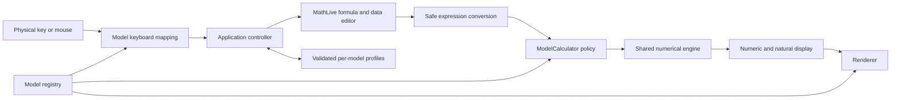

# 架构 / Architecture · 0.9.0 local

本项目使用一个共享数学引擎，再由型号配置约束可用变量、函数注册、表格容量、按键及菜单。Electron 负责本机桌面容器，Vite 将 JavaScript、CSS、数学字体打成离线资源。型号不是互相复制的计算器应用。

One mathematical engine is shared across model policies. Electron hosts the local renderer; Vite bundles all runtime assets. Model-specific configuration selects capabilities and interaction, rather than cloning the application for each device.

## 模块边界 / Module boundaries

| 层 / Layer | 文件 / Files | 职责 / Responsibility |
| --- | --- | --- |
| Mathematical Engine | `src/engine/calculator.js` | 表达式白名单、值域/有限值检查、角度、变量、复数、积分/微分、局部 SOLVE |
| Mathematical Engine | `src/engine/modes.js` | 多项式根、线性方程组、不等式、统计/回归、表格、基数、比例等算法 |
| Numerical kernels | `src/engine/root-solver.js`, `quadratic-regression.js` | 有界局部求根、尺度/零值证据；平移/缩放的加权 Householder QR，无 DOM |
| Model data/display | `src/engine/model-constants.js`, `ti-display.js` | 独立 CODATA/TI 常数集；TI 记数法、小数位与复数显示 |
| Graph engine | `src/engine/graph.js` | 安全编译、实值采样、预算限制、基本间断分段、数值单根搜索；无 DOM |
| Mathematical display | `src/engine/calculator.js`, `notation.js`, `catalog.js` | 数字/自然结果格式；LaTeX/MathJSON 转换；常数与换算数据 |
| Model Configuration | `src/models/registry.js`, `modes.js`, `ex.js` | 型号状态、可选择性、模式/快捷键顺序、变量、表格/统计上限、分布顺序、数据生命周期、按键与资料来源；EX 独立配置 |
| Model policy | `src/engine/model-calculator.js` | 在共享 Calculator 上执行型号规则、f/g 注册及循环引用检查、表格/统计容量与矩阵/向量限制 |
| Keyboard Mapping | `src/keyboard/`, `src/keys.js` | 各型号键帽、SHIFT/ALPHA 动作与桌面快捷键；X 保留旧按键定义 |
| Completion | `src/input/completion-catalog.js`, `completion.js` | 型号/模式候选，MathLive 原子范围替换、弹层、Tab/焦点/输入法保护；不执行 JS |
| CW physical UI | `src/ui/cw-keyboard.js`, `cw-home.js` | 48 键位置与六图标分页，和数学算法分离 |
| Key symbols / X–EX SOLVE UI | `src/ui/key-symbols.js`, `x-solve-panel.js` | 原创分数/带分数 SVG；X/EX 保留主算式、编辑变量值并选择未知量，不复制求根算法 |
| Formula input | `src/math-input.js`, `templates.js` | MathLive / Compute Engine 的公式输入转换、二维槽位与网格模板 |
| UI Renderer | `src/ui/`, `src/style.css`, `src/i18n.js` | 型号选择器、机身与按键 DOM、视觉样式和中英文文本 |
| Model library | `src/ui/model-picker.js`, `model-picker.css`, `model-preview.js` | 深色型号库、真实状态/覆盖声明和按键位配置生成的静态原创 SVG；无内嵌可交互计算器、重复 ID 或虚构答案 |
| X / EX appearance | `src/ui/classwiz-menu.js`, `classwiz-chassis.css` | 四列双行图标菜单、原机编号/选中标签及重叠行翻页；型号名称、银边机身和圆键布局，机身不印软件标识 |
| Distribution / Spreadsheet | `src/engine/distributions.js`, `spreadsheet.js` | 共用概率算法和 A1:E45 表格；由型号配置选择菜单顺序、输入容量与内存估算策略，不直接处理 UI 或持久化 |
| Native interaction subsets | `src/ui/physical-keyboard.js`, `graph-panel.js`, `ti-multitap.js` | 独立实体键矩阵、GRAPH 上下文软菜单、多击键替换；不复制数值算法 |
| TI mode interaction | `src/ui/ti-mode.js` | 手册六行 MODE 与四向选择，不包含数学求值；设置由 store 校验、按型号保存 |
| State Management | `src/state/store.js` | v2 数据校验、型号隔离、v1 迁移、读写失败提示；存储接口可注入 |
| Application controller | `src/main.js` | 组装模块，协调计算/参数表单/菜单、事件、焦点及持久化 |
| Desktop host | `electron/main.cjs` | 本机文件加载、窗口、安全隔离、权限/导航限制和 HTTP/WebSocket 请求阻断 |
| Compatibility tests | `tests/`, `scripts/graphical-ui-test.mjs` | 数学/解析/型号/按键/状态测试与实际 Electron 操作回归 |
| Startup / new model UI tests | `scripts/language-ui-test.mjs`, `models-ui-test.mjs` | Electron 系统语言、重启、物理键位、多击键、绘图、求根和型号隔离 |
| Usability regression | `scripts/usability-ui-test.mjs`, `tests/usability.test.js` | 已发现的数值错误、常数目录、TI MODE/分布、CG50 分析与重启/离线流程 |

## 计算路径 / Calculation path

求值仅使用允许的表达式节点、函数及变量，不使用 JavaScript `eval`。`ModelCalculator` 只增加型号规则，数值算法不读取 DOM。f/g 的定义在登记时做表达式校验及引用环检查，在执行时继续检查定义是否存在、参数与结果是否有限。

Expressions are restricted to permitted nodes, functions and symbols. The engine does not depend on the DOM. Model policy adds function registration and capacity limits; it does not duplicate numerical algorithms.

积分、微分、局部求根和多项式求根属于近似来源，渲染路径为其保留 `≈` 小数显示，不经过分数/根式识别。`ModelCalculator.assign()` 还为 Ans/已存变量保留近似来源并持久化，后续算术与注册函数继续传播该标记。普通表达式结果仍可识别有限的简单表示，不能据此宣称有精确符号来源。新增数值算法时应同时声明结果语义并检查显示回归。

## 状态协议 / State contract

`cnx-v2` 的顶层为 `{version: 2, activeModel, language, profiles}`。`cnx`、`cncw`、`cn999cw`、`cg50`、`ti36xpro`、`ex` 的 profile 各自持有允许持久化的计算器数据、历史、模式、矩阵/向量和显示设置；统计数据是否保存由型号策略决定，EX 的 `volatileStatistics` 将其排除。CG50 另保存 20 个函数槽、启用状态、视窗/轴刻度与追踪位置。容量、变量名和支持的函数定义按型号校验；EX 不接收 z 或 CW 的 f/g 定义。语言位于应用层，随任一型号更改后对整个应用生效。首次启动由 src/language.js 识别系统界面语言；Electron 在 ready 后读取 app.getPreferredSystemLanguages()，electron/preload.cjs 仅提供不可变语言列表，不暴露 IPC、Node 或文件 API；浏览器开发预览回退到 navigator.languages。有效的 v1/v2 已保存语言优先，缺失或损坏时使用检测结果。

持久化只接受有限实数和受约束的结构；数据尺寸、有效型号、角度/格式枚举、历史条数等在读取时校验。当前算式、未提交表单、SHIFT/ALPHA、返回栈、撤销栈、临时错误、MatAns/VctAns 等属于会话。切换型号先保存原型号资料，再加载新型号，清空会话输入；不能把 X 的 M 或历史带进 CW。

第一次发现旧 `cnx-v1` 时仅生成 X profile，并保留原键。不能把 v1 无条件复制给所有型号。损坏数据回到可启动的默认状态并显示提示；存储写入失败不应默默显示“已保存”。清理 Electron 用户数据目录会删除本机记录；目前没有云同步。

Only validated profile data is persisted. Transient editor state is cleared when switching models. Legacy v1 migrates to X only and is retained as a backup. Storage failures are visible; no online synchronization is used.

## 当前边界与后续重构 / Remaining coupling

SOLVE 的型号入口由 `solveLocation` 配置区分：X/EX 在 Calculate 使用主编辑器方程，CW/999 转入 Equation。共享 `Calculator.solve(expr, guess, extra, variable)` 接受被选未知量，变量赋值与近似来源仍由控制器处理。计算屏使用独立的公式/结果网格轨道和各自滚动容器，避免高公式越界覆盖答案；主算式不再显示额外矩形输入框。机身按可用窗口尺寸缩放，键帽与 SHIFT 标记各有空间。该布局不是点阵固件复刻。

EX 的 `menuShortcuts`、独立英文按键和十二模式顺序不从 CN X 名称推断。四列菜单的数字/字母编号为 1–9/A/B/C，下移时将可见范围从 1–8 改为 5–C；控制器将实体/桌面动作映射到同一模式配置。型号库的静态预览只读取配置，不参与求值或状态；详情见 [INTERFACE.md](INTERFACE.md) 与 [FX991EX.md](FX991EX.md)。

`main.js` 仍负责很多表单、菜单与输入协调，尚未成为完全独立的控制器集合；`i18n.js` 包含文本映射，部分公共目录也是桌面工作流。当前拆分优先保证 X 回归和可测试边界。后续应逐模式抽离控制器、使用稳定的语义消息键与模式动作接口，并在每次抽离后运行旧回归及新型号测试。不能以目录已拆分推断所有耦合已消除。

The main controller remains substantial. Further extraction should be incremental, with existing X regression checks retained. Shared desktop menus and translated labels do not establish hardware compatibility by themselves.

## 测试与发行 / Tests and distribution

999 与 EX 的数值分布共用 `src/engine/distributions.js`，电子表格引用、重算与填充/复制共用 `src/engine/spreadsheet.js`；通过 `ModelCalculator` 的 capability 检查开放，991CN X/CW 不因此获得这些独立应用。EX 配置七种分布的顺序、正态参数 σ 在 μ 前，以及离散列表容量。CW 的物理键位和公共配置共用，HOME 顺序由型号配置决定。`src/ui/spreadsheet-panel.js` 负责线性编辑和网格操作，与数学计算分离；分布菜单仍由主控制器协调。

电子表格、分布参数和列表是会话数据，不进入 `AppStore`。999 的表格可在当前会话跨应用保留；EX 的 `spreadsheetLifecycle: 'leave-app'` 在激活其他应用时清空，`volatileStatistics` 同样清空已提交统计数据；关闭电源、重启或切换型号不恢复表格。表格引擎读取 `spreadsheetMemory`：EX 每常数 10 字节、公式开销 11 字节及常数输入 10 字节限制，默认策略则保留 999 的常数/公式预算。两者的 1,700 字节预算按文本 token 估算，不声明等同厂商固件编码或所有依赖链内存限制。持久历史、允许的变量和设置继续复用经校验的独立 profile。

`npm test` 使用 Node 测试运行器测试无 DOM 模块；`npm run test:ui` 通过 Playwright 启动真实 Electron 窗口，使用独立临时 profile，检查操作流程及 JavaScript 错误并保存证据。核心测试通过不能替代 UI 验证，源码 UI 通过也不能替代打包程序验证。

`npm run release:win` 生成便携 EXE 与 `win-unpacked`，不会发布到 GitHub。GitHub Actions 使用只读仓库权限，运行 Linux 核心与 Windows UI/打包检查。依赖通知由 `scripts/dependency-licenses.mjs` 离线收集；Electron 自带的 Chromium 许可也须保留。
