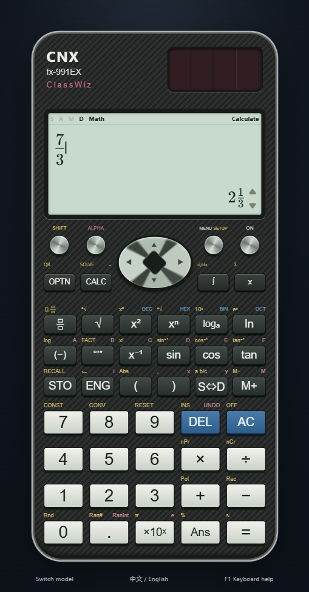
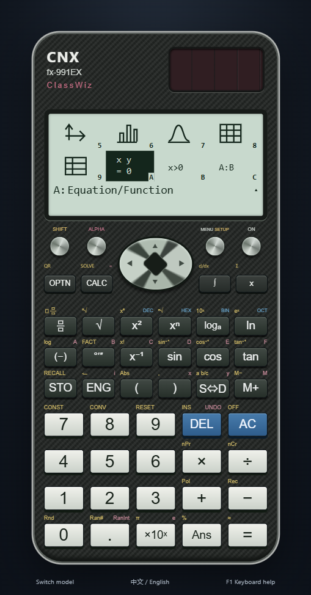
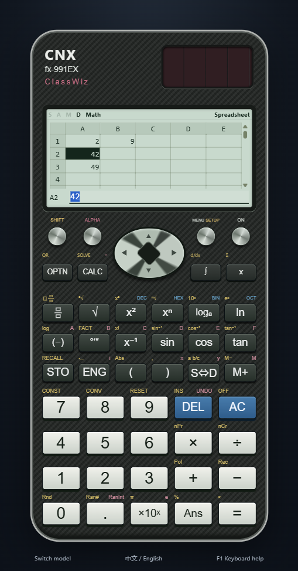

# fx-991EX: experimental desktop implementation

The fx-991EX is selectable as an **Experimental** model. It has its own configuration and English physical key legends, and shares the project's mathematical engine. This is a usable implementation of a documented subset, not an emulator, a firmware distribution or a claim of complete handheld equivalence.

## Reference material

- [Official fx-991EX product page and front photograph](https://www.casio.com/us/scientific-calculators/product.FX-991EX/): model identity and the physical arrangement of the case, solar panel, navigation and keys.
- [Casio fx-570EX / fx-991EX User's Guide, RJA532432-001V01](https://www.casio.com/content/dam/casio/global/support/manuals/calculators/pdf/004-en/f/fx-570_991EX_EN.pdf): memory, CALC/SOLVE, statistics, tables, distributions and spreadsheet policies. Relevant printed pages are 13, 18–20, 27–28, 31–33 and 37–39.
- [Official fx-991EX Quick Start Guide](https://www.casio.com/content/dam/casio/local/us/cpd/pdf/Casio-fx-991EX-QSG.pdf), p.2: the twelve applications; later sections give worked examples.

The references distinguish EX from CN X and CW. The guide specifies a Calculate-only Newton solver, nine named memories, table capacities of 45/30 rows, statistics capacities of 160/80/53 rows, and a 45-by-5 spreadsheet cleared when leaving its mode. The application implements explicit policies for these differences. Reference images are consulted for development; they are not bundled as application skins.

## Implemented model policy

The source of the following application behavior is [src/models/ex.js](../src/models/ex.js), with separate legends in [src/keyboard/ex.js](../src/keyboard/ex.js).

| Area | Current implementation |
| --- | --- |
| Main menu | Calculate, Complex, Base-N, Matrix, Vector, Statistics, Distribution, Spreadsheet, Table, Equation/Function, Inequality, Ratio; shortcuts `1`–`9`, `A`, `B`, `C` |
| Menu layout | Four columns, two visible rows; scrolling down reveals entries `5` through `C`, retaining the overlapping row |
| Memories | `A`, `B`, `C`, `D`, `E`, `F`, `M`, `x`, `y`, plus the answer register; unsupported `z` is rejected |
| Registered functions | No CW-style persistent `f` / `g` registration; Table takes its expressions directly |
| Constants | The project's 47-entry CODATA 2010 catalog; not the CW CODATA 2018 catalog |
| Table | At most 45 rows for one expression, 30 for two; excess requested rows produce an error |
| Matrix / Vector | Four named matrix memories, dimensions up to 4×4; four vector memories, dimensions 2 or 3 |
| Equation/Function | Systems with 2–4 unknowns; polynomial equations of degree 2–4 |
| Statistics | 160 rows for one column; 80 for two; 53 for three. Frequency occupies a column. Submitted data is cleared after changing to another application and is excluded from saved profiles |
| Distribution | Normal PD, Normal CD, Inverse Normal, Binomial PD, Binomial CD, Poisson PD, Poisson CD; discrete lists limited to 45 entries |
| Normal parameters | PDF: `x`, `σ`, `μ`; CDF: lower, upper, `σ`, `μ`; inverse: area, `σ`, `μ` |
| Base-N | DEC/HEX/BIN/OCT physical keys, direct physical A–F entry in hexadecimal, saved base and signed 32-bit Ans continuation |
| Spreadsheet | `A1:E45`; constants, formulas, relative/absolute references, range aggregation, fill, copy/cut and recalculation |

Shared operations include arithmetic, fractions, powers, roots, angle units, complex arithmetic, numerical calculus, regression and base calculations. Model constraints limit the available dimensions, variables and modes. A shared operation is not evidence that every corresponding handheld input domain or menu sequence is reproduced.

The original menu labels are `1`–`9` and `A`–`C`; `0` remains an additional desktop alias for the tenth application. Turning frequency off ignores the hidden frequency values, and full initialization clears session sheets and distribution parameters as well as the current profile.

## CALC and SOLVE

Enter the equation in **Calculate**, the first application. **ALPHA CALC** inserts equality; **SHIFT CALC** opens SOLVE while retaining that equation. Enter the starting value, select the desired unknown when several variables occur, and press `=` / Enter. The result shows the selected variable and the residual `L−R`. Equation/Function remains the entry point for polynomial and simultaneous equations.

For example, enter `x²+B=0`, set `x=1` and `B=−2`, select `x`, and solve. The shared numerical solver returns a local real root near √2. A negative initial value can instead select the negative root. It does not enumerate all roots and may reject difficult or numerically unresolved inputs. The guarded desktop algorithm and convergence behavior are not identical to firmware.

## Distribution and spreadsheet behavior

The distribution menu and Normal parameter order are EX-specific. Invalid parameters, such as a nonpositive standard deviation, are rejected. Probability results use approximate numerical values, not fabricated exact fractions.

Spreadsheet contents remain available while using the sheet's editing/tools screens. Activating another application clears them. Restarting or switching models also starts an empty sheet; formulas are not persisted in the profile. The project simulates the 1,700-byte capacity with ten bytes per constant and formula overhead of eleven bytes plus a token-count estimate. Its encoding and reference-chain memory behavior are not firmware-exact. A full `A1:E45` grid does not imply all cells can be filled within that limit.

## Known differences and validation

- **SHIFT OPTN / QR is unavailable.** The app reports this explicitly; there is no online service or substitute result.
- MathLive input, KaTeX output, desktop fonts, original vector icons and CSS chassis geometry differ from a dot-matrix handheld display. Full key-by-key, error-position and setup-menu equivalence remains unfinished.
- Several editors and results use desktop forms and scrolling. Full native list-entry, continuation and diagnostic dialogs are not reproduced.
- Persistent per-model history, saved variables/settings and interface language selection are desktop features. They do not reproduce every handheld memory-clear event.
- Binary floating-point arithmetic, bounded exact-form recognition and numerical algorithms can differ in final digits, rounding and accepted domains. Passing worked examples does not prove all-input equivalence.

[tests/ex.test.js](../tests/ex.test.js) covers independent metadata, keys, memories, solver policy, limits and selected manual examples. Actual execution results and packaged-app evidence belong in [VERIFICATION.md](VERIFICATION.md); this page deliberately makes no final test-count claim. See [INTERFACE.md](INTERFACE.md) for visual scope and [COMPATIBILITY.md](COMPATIBILITY.md) for the project-wide boundary.

中文摘要：fx-991EX 目前是可以实际操作的实验型号，具有独立英文键位、十二模式、分布与电子表格策略。SOLVE 位于第一个计算模式。电子表格切换到其他应用后清空；统计数据不持久化。它仍未达到整机真机等价，QR 等未实现能力会明确提示。
