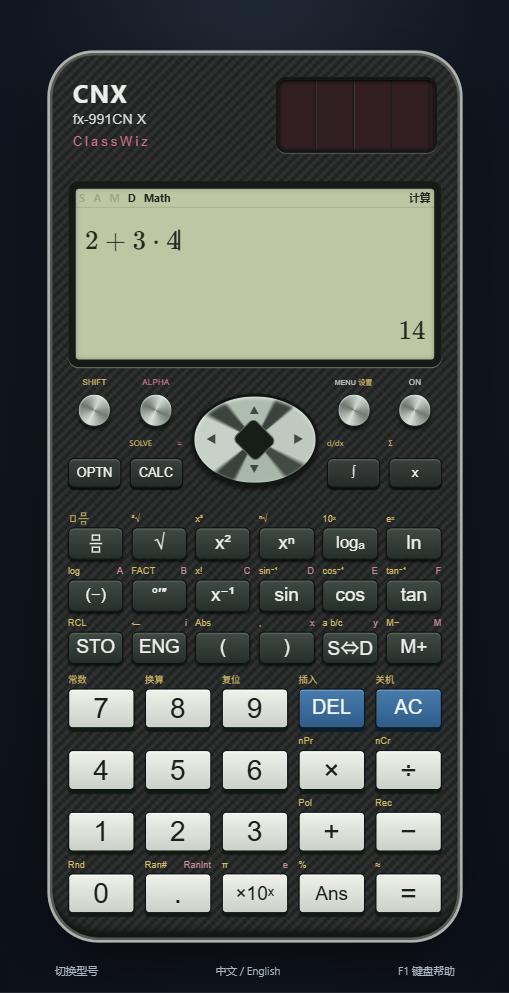
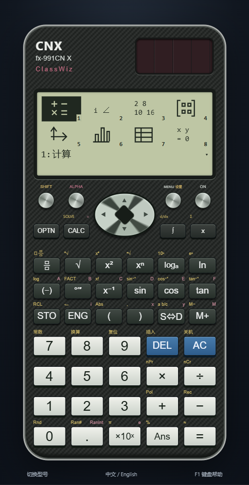

# Model library and calculator appearance

The application separates its desktop model library from each calculator's physical interface. The library provides model selection and implementation status; each device retains its configured controls, display and model identification. The redesign improves presentation without treating a change of color or name as support for another model.

## Model library

The dark library displays a miniature calculator, brand/reference name, exact model name, implementation status, feature summary and coverage statement. The active model has a check and a **Current model** label. Cards are generated from the registry, so future models receive the same status and availability rules. Experimental remains a usable subset; it is not renamed to fully supported after a small set of checks.

Selecting an enabled card opens that model immediately. The first launch requires a selection; Escape cannot dismiss it before a model has been chosen. Later, **Return to calculator** or Escape closes the library. The language control remains available from the selection screen.

Model profiles separately keep their history, supported memories and settings. Language is shared, the last model is remembered, and switching clears unfinished input. Individual models may intentionally keep some data volatile: EX statistics and spreadsheet behavior are documented in [FX991EX.md](FX991EX.md). The selection footer explains the common state policy.

## Original vector previews

[model-preview.js](../src/ui/model-preview.js) generates SVG previews from the model's physical key data. X/EX, CW, CG and TI use distinct arrangements; the white CW case is also represented. The previews include model identification, the solar panel where appropriate, screen proportions and actual key legends. Their screens remain blank: they show no invented answers, rendered plots or unsupported feature demonstrations.

These previews are miniature original drawings, not product photographs or certified scale replicas. They contain no embedded calculator controls, duplicate DOM identifiers or calculation state. They are hidden from accessibility APIs and inert so keyboard and pointer interactions reach the model-selection card alone. The card text supplies the accessible model information.

## X / EX chassis and menus

The X/EX case uses a silver outer edge, a dark patterned body, a tall solar panel and model/ClassWiz identification. No application mark is printed on the body, cover or preview. Four small round upper controls flank a wide oval navigation pad. The lower controls, science keys and light/blue number keys follow the model's configured physical rows. The fraction key uses stacked numerator and denominator boxes rather than slash-separated text.

[classwiz-chassis.css](../src/ui/classwiz-chassis.css) contains this original CSS geometry. Visual references are the [official CN X front photograph](https://www.casio.com.cn/scientific-calculators/product.FX-991CNX-BK/) and [official EX product images](https://www.casio.com/us/scientific-calculators/product.FX-991EX/); the [EX Quick Start Guide](https://www.casio.com/content/dam/casio/local/us/cpd/pdf/Casio-fx-991EX-QSG.pdf) supplies the application descriptions. See [MODEL_REFERENCES.md](MODEL_REFERENCES.md) for other models.

The main menu uses four columns and two visible rows, monochrome vector icons, numeric/letter markers and the selected application's label below. X keeps its ten modes; EX has its separate twelve-mode ordering. Paging changes the visible rows inside the display rather than scrolling the surrounding application. Existing input/display corrections remain documented in [NATIVE_INPUT.md](NATIVE_INPUT.md).

## Accessibility and small windows

The library scrolls within the dialog, retains a visible language header and adapts to one column in narrow windows. Cards and return/language controls use native buttons with visible keyboard focus. Planned cards, if any, are disabled. The interface respects reduced-motion preferences, and preview artwork does not add extra focus stops.

The calculator frame scales to available window space. Formula entry and answers occupy separate bounded regions; taller formulas scroll within their own area. These controls address the reported overlap, but do not certify every monitor, Windows DPI setting, font fallback or arbitrary expression depth. Current run results, sizes and screenshots are reported in [VERIFICATION.md](VERIFICATION.md).

## Branding and remaining differences

**The application is named scientific calculator simulator.** Model and manufacturer names identify the hardware being referenced; calculator bodies, covers and previews carry no shared application mark. The application does not reproduce a manufacturer logo, bundle protected product images or firmware, or claim manufacturer approval. There is no fixed “Chinese edition” label on a device: the model name remains the same when the interface language changes.

Fonts, dot-matrix rendering, exact proportions, native menu transitions and all secondary key behaviors still require comparison. Product-library thumbnails and a closer CSS chassis do not establish functional or pixel-level equivalence. The screenshots above show this application, not a physical calculator. The project keeps these visual limits separate from mathematical and model-specific validation.

中文摘要：软件名为 scientific calculator simulator。型号库展示真实型号资料和开发状态，缩略图由键位配置生成，不使用原厂图片或虚构计算结果。机身、盖子和缩略图不印通用软件标识；设备不加“中文版”等固定标签。外观改进不代表已经达到逐像素或逐键真机等价。
