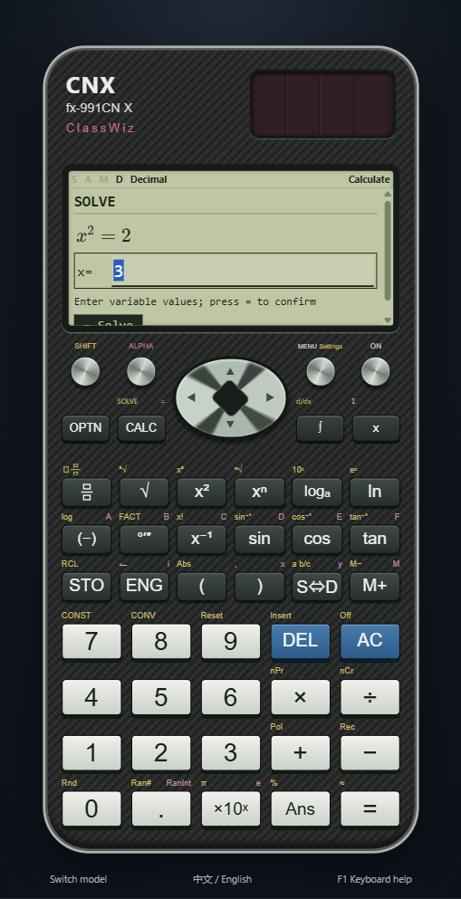
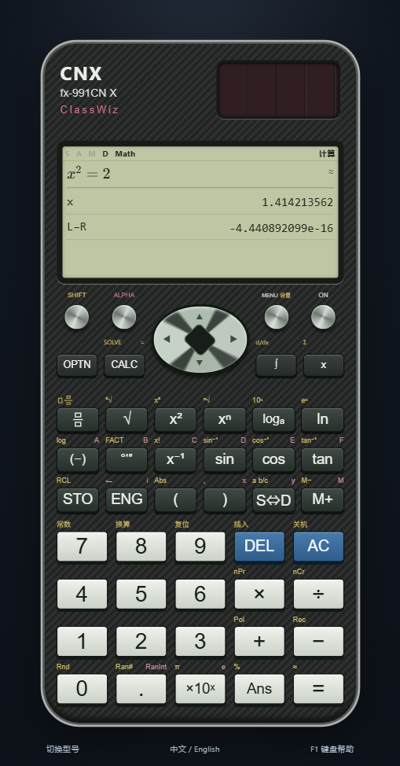
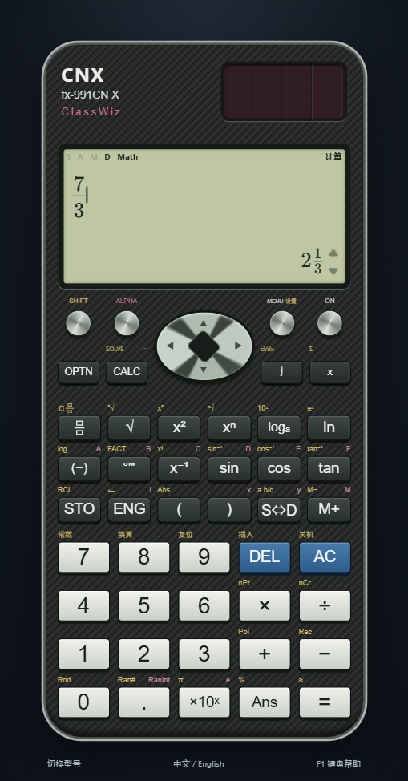
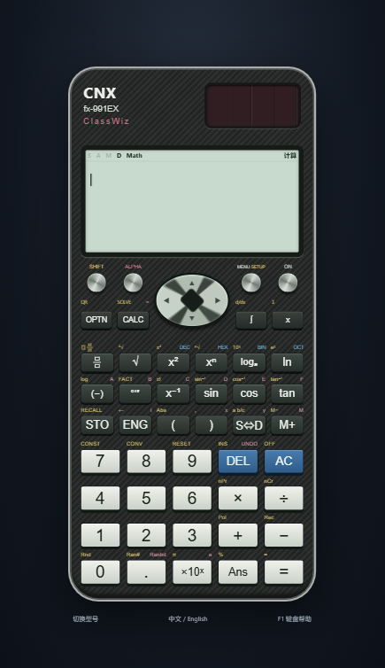

# Native input and layout corrections: 0.8.2

Follow-up in 0.9.3: the LCD frame and calculation viewport use non-scrolling clipping, keeping the D / Math status row fixed when MathLive requests automatic scrolling. Formula/result regions retain their own scrolling. Empty results no longer reserve LCD space, and unfinished input gets additional top padding. The dedicated `npm run test:ui:fractions` check covers all six models, simple and nested fractions, numerator/denominator navigation, numerical results and 125%/150% narrow-window scaling.

Follow-up in 0.8.3: remove the main editor's rectangular focus outline, bottom border and focus background. The formula sits directly on the LCD while the caret and selection remain available. Actual Electron checks exercise blank, editing and blurred states on X/CW/999; parameter forms keep their existing affordances. [Blank display](entry-frame-after-blank.png) · [Formula and answer](entry-frame-after-answer.png).

This local update addresses the reported fraction-key mismatch, overlapping input/display/key labels, and the incorrect X SOLVE entry point. It does not establish full device equivalence. The application uses its own fonts, vectors and mathematical engine; no manufacturer photograph, logo or firmware is bundled.

## References

- [Casio fx-991CN X product page and front photograph](https://www.casio.com.cn/scientific-calculators/product.FX-991CNX-BK/): stacked fraction boxes/bar, SHIFT mixed-number symbol and CALC with ALPHA equality / SHIFT SOLVE.
- [Casio-authored CN X manual, mirrored PDF](https://manuals.plus/m/9c6b41d1f8e83c52eb602fd18a154beda8144dbb748a12661712ebc2dcaac12c.pdf), printed pp.19 and 35–36: fractions, Calculate-only Newton SOLVE, variable values/selection, decimal solution and L−R. This is a third-party-hosted copy of the manufacturer-authored manual, not an official Casio hosting URL.
- [Official first-generation CN CW fraction guide](https://support.casio.com/global/cn/calc/manual/fx-991CNCW_999CNCW_cn/basic_calculations/fraction_calculations.html) and [manual index](https://support.casio.com/global/cn/calc/manual/fx-991CNCW_999CNCW_cn/): preceding-numerator capture, SHIFT mixed-number entry and Equation Solver. See also the model-specific sources in [MODEL_REFERENCES.md](MODEL_REFERENCES.md).

Reference material was consulted on 2026-10-23. Research photographs stay outside distributed application files.

## Verified X workflow

1. Open the first **Calculate** mode and enter `x²`. Press the right arrow to leave the exponent.
2. Press **ALPHA**, then **CALC** to enter `=`; enter `2`.
3. Press **SHIFT**, then **CALC**. The existing equation stays visible; there is no blank equation form and no mode switch.
4. Enter `1` as the value of x and press `=` / Enter. The result is approximately 1.414213562 with an L−R residual; the saved mode remains Calculate.
5. AC returns to the original equation. Reopening SOLVE uses the saved x value.

The manual's `x²+B=0` example is also exercised: enter x=1, then B=−2, confirm the last value, move up to highlight x, and solve. Highlighting B instead with x=3 solves B=−9 without overwriting x. Desktop Shift+F6 and physical SHIFT CALC share this policy. The X Equation menu remains polynomial/system solving. CW/999 Solver remains in Equation; their desktop Shift+F6 shortcut enters that application.

## Fraction input and display

- The fraction key uses two vertically stacked boxes separated by a horizontal bar. SHIFT uses a whole-number box alongside a fraction. These are original SVG geometry; TI's n/d text is retained.
- On X, `7`, fraction key, `3`, `=` yields 7/3. The fraction key captures the preceding operand rather than silently creating a mixed number.
- From blank input, fraction key, `2`, down arrow, `3`, `=` yields 2/3. Both CW profiles also capture the preceding numerator.
- The physical division key inserts an infix division operator. SHIFT fraction starts a new mixed-number entry, including after a result. Tab advances its input placeholders.
- X SHIFT S⇔D converts 7/3 to 2 1/3 on the main answer line. Formatting derives both whole and remainder from the recognized rational pair; it does not subtract the whole part from an inexact binary value. Plain S⇔D toggles decimal/standard format.
- Approximate calculus output remains approximate decimal output when mixed formatting is requested. Fraction recognition on ordinary results remains bounded numerical recognition, not symbolic proof.

## Input, screen and button overlap

Formula entry and the answer now occupy separate grid rows with a gap and independent scrolling boundaries. Tall expressions scroll within the input region; they cannot paint over the answer. Result labels and values use bounded columns. CW SHIFT captions have a reserved strip above each key, without negative horizontal offsets into neighboring key columns. Direction/page keys use SVG paths instead of overlapping fallback-font arrow glyphs.

Actual Electron checks cover Chinese and English key text, control captions and SHIFT/ALPHA labels within their columns; primary labels stay inside their keycaps. X, CW and 999 are also exercised in a 360×640 window at 100%, 125% and 150% Electron zoom. Native window captures confirm the entire chassis and keys remain visible. These zoom checks complement, rather than certify, every possible Windows monitor/DPI/font combination.

## Remaining differences

SOLVE finds one local real root; the initial value can change the result and no all-roots guarantee is made. Its guarded numerical algorithm may differ from firmware iteration and convergence behavior. Variable prompts currently use linear editable fields; full native iteration/continuation dialogs, error positioning, dot-matrix rendering, scrolling and every key sequence remain unfinished. Very deep formulas need scrolling within the small display. No complete physical-device comparison was performed, and all existing model statuses are retained. See [COMPATIBILITY.md](COMPATIBILITY.md) and [VERIFICATION.md](VERIFICATION.md).
